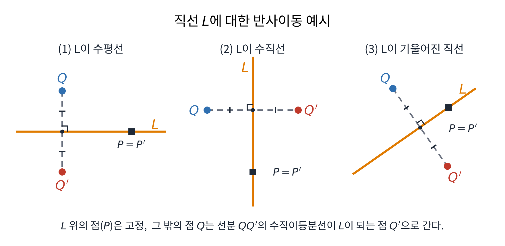
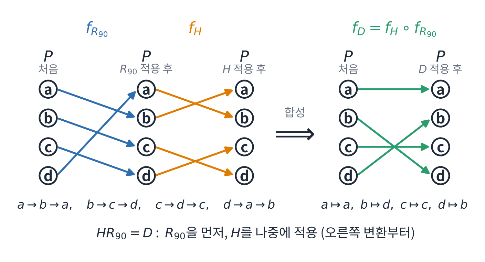
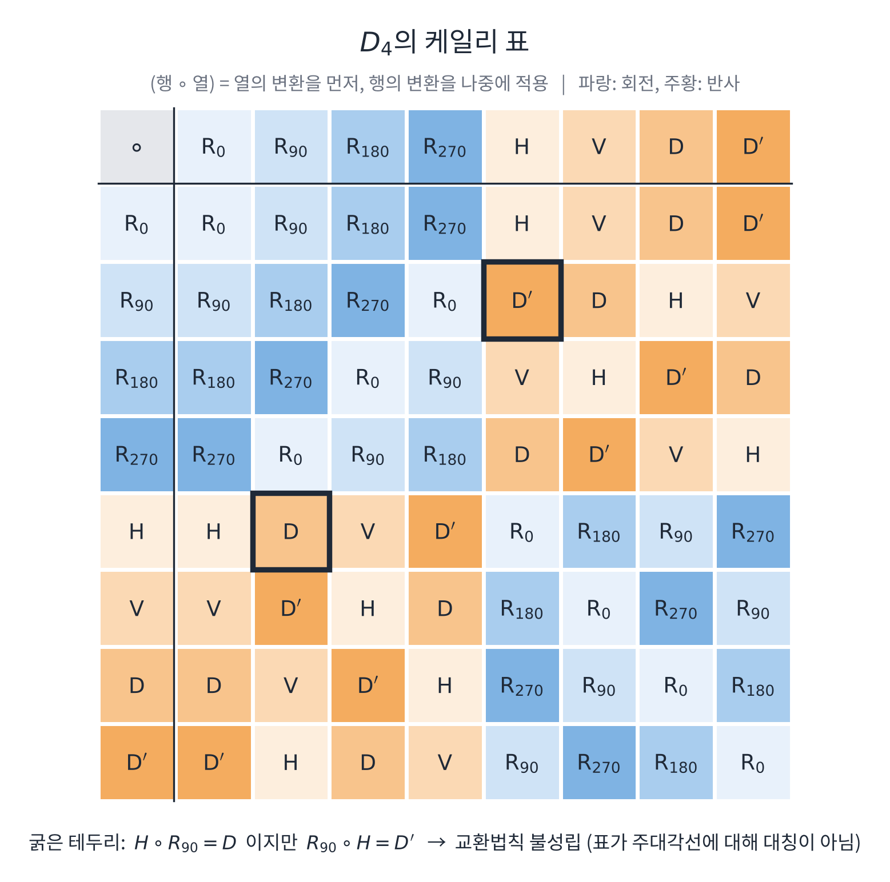
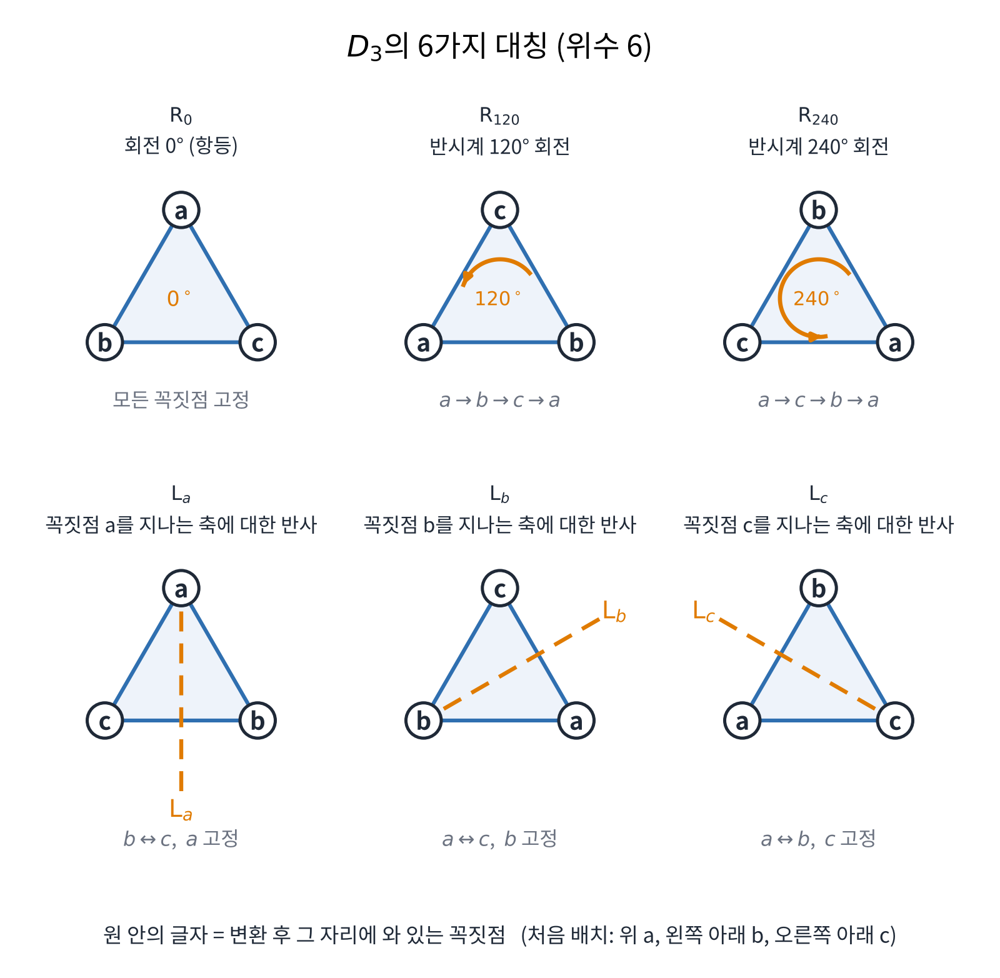
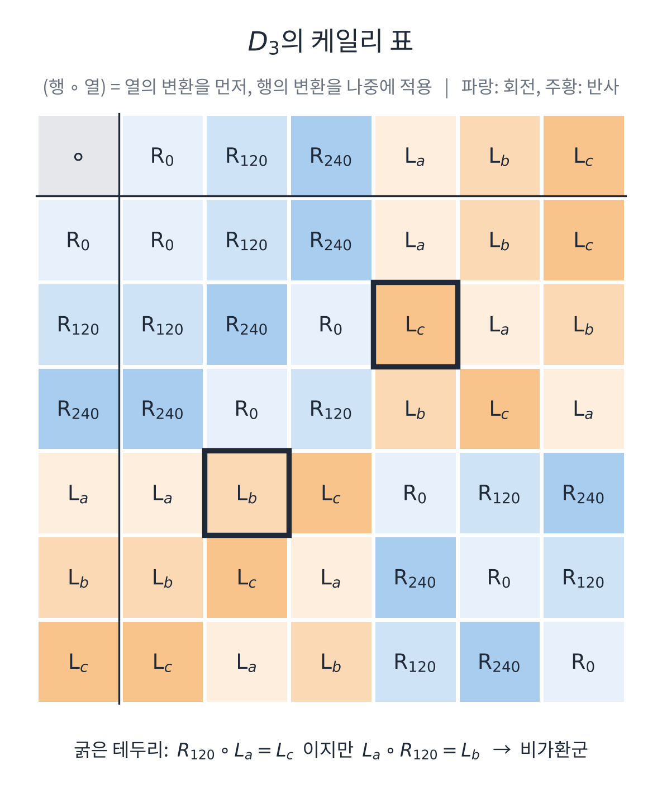
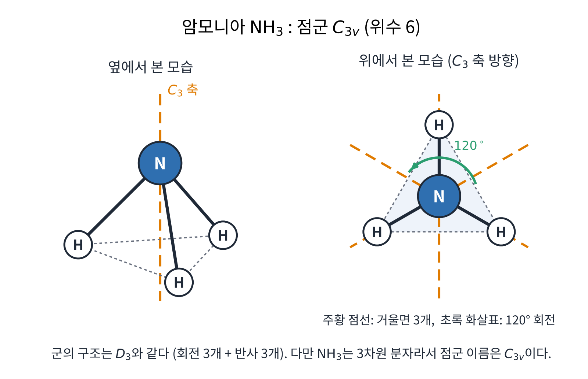

교재: 『현대대수학 바이블』 제1장 군의 개요 (1.1 정사각형의 대칭, 1.2 정이면체군)

이 글은 교재를 읽으며 정리한 개인 노트를 블로그 글로 다듬은 것이다. 내용은 직접 정리했고, 오개념 검토와 일부 문장 수정, 그림 제작에는 AI(Claude)의 도움을 받았다. 틀린 부분을 발견하면 이메일로 알려 주기 바란다.

## 개요

군의 정의를 내리기 전에 정사각형의 대칭에서 출발해 `정이면체군(dihedral group)`을 살펴보는 장이다. 대칭을 합성하는 방법을 `케일리 표(Cayley table)`로 정리하고, 그 표에서 군이 되기 위한 조건이 어떻게 드러나는지 본다. 함수의 합성과 전단사함수는 [Abstract Algebra Notes 01](/posts/algebra-01-intro/)에서 정리한 내용을 쓴다.

> 도형의 대칭 전체는 합성에 대해 군을 이루고, 정 $$ n $$각형의 대칭군이 위수 $$ 2n $$인 정이면체군 $$ D_n $$이다.
{: .prompt-info }

**키워드**: 대칭성, 정이면체군, 위수, 케일리 표

## 정의

### 대칭과 반사이동

도형을 회전하거나 반사시켜 얻은 결과가 처음과 같으면 그 변환을 `대칭(symmetry)`이라 한다. 이때 도형의 형태(figure)가 유지되어야 한다. 평면에서는 이를 다음과 같이 정확하게 정의한다.

**정의 1 (평면대칭).** 평면 도형 $$ F $$의 `평면대칭(plane symmetry)`은 평면에서 평면으로 가는 전단사함수 $$ f $$로서, $$ F $$를 $$ F $$로 옮기고 ($$ f(F) = F $$) 거리를 보존하는 것이다. 즉 평면의 임의의 점 $$ p, q $$에 대해 $$ p, q $$ 사이의 거리와 두 점의 상 $$ f(p), f(q) $$ 사이의 거리가 같다.

평면도형의 `대칭군(symmetry group)`은 그 도형의 모든 대칭을 모은 집합이다.

**정의 2 (반사이동).** 직선 $$ L $$에 대한 `반사이동(reflection)`은 $$ L $$ 위의 모든 점을 고정하고, $$ L $$ 위에 있지 않은 모든 점 $$ Q $$를 점 $$ Q' $$으로 대응시켜 $$ L $$이 선분 $$ QQ' $$의 수직이등분선이 되도록 하는 함수이다.


*L이 수평선, 수직선, 기울어진 직선일 때의 반사이동. L 위의 점 P는 그대로이고 Q는 Q′으로 간다.*

### 정이면체군

**정의 3 (정이면체군).** 정 $$ n $$각형 ($$ n \ge 3 $$)의 모든 대칭을 합성에 대해 모은 군을 `정이면체군(dihedral group)`이라 하고 $$ D_n $$으로 표기한다. 이 군의 `위수(order)`, 즉 원소의 개수는 $$ 2n $$이다.

- 책에 따라 위수 $$ 2n $$인 군을 $$ D_{2n} $$으로 표기하기도 한다. 이 글에서는 $$ D_n $$을 위수 $$ 2n $$인 군으로 쓴다.
- 위수가 $$ 2n $$인 정이면체군을 정 $$ n $$각형의 대칭군이라고도 한다. 순열들의 군 $$ S_n $$을 부르는 '대칭군'과는 다른 뜻이다.

### 군과 아벨군

**정의 4 (군).** 집합 $$ G $$와 그 위의 연산이 다음 네 조건을 모두 만족하면 `군(group)`이다.

- `닫힘(closure)`: 두 원소를 연산한 결과가 다시 $$ G $$ 안에 속한다.
- `결합법칙(associativity)`: $$ (AB)C = A(BC) $$가 성립한다.
- `항등원(identity)`: 모든 원소 $$ A $$에 대해 $$ Ae = eA = A $$를 만족하는 $$ e $$가 있다. $$ D_4 $$에서는 $$ R_0 $$이다.
- `역원(inverse)`: 모든 원소 $$ A $$에 대해 $$ AB = BA = e $$를 만족하는 $$ B $$가 있다. 이때 $$ A, B $$는 서로의 역원이다.

**정의 5 (아벨군).** 군의 네 조건에 더해 교환법칙 ($$ ab = ba $$)을 만족하면 `가환군(abelian group)` 또는 아벨군이라 한다. 그렇지 않으면 `비가환군(non-abelian group)`, 비아벨군이라 한다.

### 순환회전군

**정의 6 (순환회전군).** 반사이동으로는 대칭을 이룰 수 없고 회전대칭만 존재하는 도형(예: 바람개비)의 대칭군을 위수가 $$ n $$인 `순환회전군(cyclic rotation group)`이라 한다. 회전각은 $$ (360 \cdot k)/n $$ ($$ 0 \le k \le n-1 $$)이고, $$ \langle R_{360/n} \rangle $$로 표기한다.

## 정리와 증명

**정리 1 (대칭군).** 도형 $$ F $$의 대칭 전체는 합성에 대해 군을 이룬다.

**증명.** 두 점 $$ p, q $$ 사이의 거리를 $$ d(p, q) $$로 쓰고, 네 조건을 차례로 확인한다.

- 닫힘: $$ f, g $$가 $$ F $$의 대칭이면 둘 다 전단사이고 거리를 보존하므로 $$ f \circ g $$도 전단사이고 거리를 보존한다. 또 $$ (f \circ g)(F) = f(g(F)) = f(F) = F $$이다.
- 결합법칙: 함수의 합성은 결합법칙을 만족한다.
- 항등원: 항등함수는 $$ F $$의 대칭이다.
- 역원: $$ f $$는 전단사이므로 역함수 $$ f^{-1} $$가 있다. 모든 점 $$ p, q $$에 대해 $$ d(f^{-1}(p), f^{-1}(q)) = d(f(f^{-1}(p)), f(f^{-1}(q))) = d(p, q) $$이므로 $$ f^{-1} $$도 거리를 보존한다. 또 $$ f(F) = F $$의 양변에 $$ f^{-1} $$를 적용하면 $$ f^{-1}(F) = F $$이다. ∎

**정리 2 (케일리 표의 성질).** 유한군의 케일리 표에서 각 행과 각 열에는 모든 원소가 정확히 한 번씩 나타난다.

**증명.** 어떤 행에서 $$ AB = AC $$라 하자. 양변의 왼쪽에 $$ A $$의 역원을 곱하면 $$ B = C $$이므로 한 행에 같은 원소가 두 번 나타날 수 없다. 한 행의 칸 수는 군의 위수와 같으므로 모든 원소가 정확히 한 번씩 나타난다. 열도 같은 방법으로 보인다. ∎

**정리 3 (결정학적 제한 정리).** 주기적인 격자를 가진 결정에서는 $$ n = 5 $$ 또는 $$ n \ge 7 $$인 $$ n $$겹 회전대칭이 불가능하다. (비주기적인 준결정은 예외이다.) 결정의 점군 중 정이면체군 꼴은 $$ D_2, D_3, D_4, D_6 $$이다.

증명은 아직 공부하지 못했다. 따로 공부해서 채울 예정이다.

> 이 정리는 결정에서 나타날 수 있는 대칭에 대한 제한이다. $$ D_5 $$ 같은 군이 수학적으로 존재하지 않는다는 뜻은 아니다.
{: .prompt-warning }

## 예제

### 1. 정사각형의 대칭과 합성

정사각형의 꼭짓점을 왼쪽 위 $$ a $$, 왼쪽 아래 $$ b $$, 오른쪽 아래 $$ c $$, 오른쪽 위 $$ d $$로 둔다. 정사각형은 회전대칭이 4개, 반사대칭이 4개 존재한다.

- 회전: $$ R_0, R_{90}, R_{180}, R_{270} $$ (반시계 방향, 단위는 도)
- 반사: $$ H, V, D, D' $$. 각각 수평선(Horizontal), 수직선(Vertical), 두 대각선(Diagonal)에 대한 반사이다.
- $$ D $$는 꼭짓점 $$ a, c $$를 지나는 대각선(왼쪽 위–오른쪽 아래), $$ D' $$는 꼭짓점 $$ b, d $$를 지나는 대각선(왼쪽 아래–오른쪽 위)에 대한 반사로 정한다.

> $$ D' $$는 $$ D $$의 역원이 아니라 반대쪽 대각선에 대한 반사이다. 반사는 두 번 하면 원래대로 돌아오므로 $$ D $$의 역원은 $$ D $$ 자신이다.
{: .prompt-warning }

각 변환을 적용하면 꼭짓점의 배치가 다음과 같이 바뀐다. 행렬의 첫째 줄은 왼쪽 위와 오른쪽 위, 둘째 줄은 왼쪽 아래와 오른쪽 아래 자리에 놓인 꼭짓점을 뜻한다. 변환을 나타내는 행렬이 아니라 자리를 표시한 것이다. 화살표의 왼쪽이 처음 배치, 오른쪽이 변환한 뒤의 배치이고, $$ R_0 $$은 변환하지 않은 처음 모양이다.

회전:

$$
\begin{aligned}
R_0 &: \begin{pmatrix} a & d \\ b & c \end{pmatrix} \to \begin{pmatrix} a & d \\ b & c \end{pmatrix} \\[8pt]
R_{90} &: \begin{pmatrix} a & d \\ b & c \end{pmatrix} \to \begin{pmatrix} d & c \\ a & b \end{pmatrix} \\[8pt]
R_{180} &: \begin{pmatrix} a & d \\ b & c \end{pmatrix} \to \begin{pmatrix} c & b \\ d & a \end{pmatrix} \\[8pt]
R_{270} &: \begin{pmatrix} a & d \\ b & c \end{pmatrix} \to \begin{pmatrix} b & a \\ c & d \end{pmatrix}
\end{aligned}
$$

반사:

$$
\begin{aligned}
H &: \begin{pmatrix} a & d \\ b & c \end{pmatrix} \to \begin{pmatrix} b & c \\ a & d \end{pmatrix} \\[8pt]
V &: \begin{pmatrix} a & d \\ b & c \end{pmatrix} \to \begin{pmatrix} d & a \\ c & b \end{pmatrix} \\[8pt]
D &: \begin{pmatrix} a & d \\ b & c \end{pmatrix} \to \begin{pmatrix} a & b \\ d & c \end{pmatrix} \\[8pt]
D' &: \begin{pmatrix} a & d \\ b & c \end{pmatrix} \to \begin{pmatrix} c & d \\ b & a \end{pmatrix}
\end{aligned}
$$

이런 이동을 함수(mapping)로 보면 합성할 수 있고, 그 결과는 하나의 변환과 같다. 예를 들어 $$ R_{90} $$을 한 뒤에 $$ H $$ 대칭이동을 하면 결과는 $$ D $$와 같다. 따라서 $$ HR_{90} = D $$라고 쓴다. 함수의 합성처럼 오른쪽 변환을 먼저 적용한다.

이해를 돕기 위해 집합 $$ P = \{a, b, c, d\} $$에서 $$ P $$로 가는 함수 $$ f_g $$를 정의한다. 변환 $$ g $$에 대해 $$ f_g(x) $$는 '꼭짓점 $$ x $$가 $$ g $$로 이동해서 도착한 자리에 원래 있던 꼭짓점'이다.

- $$ f_{R_{90}} $$: $$ a \to b,\ b \to c,\ c \to d,\ d \to a $$
- $$ f_{H} $$: $$ a \to b,\ b \to a,\ c \to d,\ d \to c $$
- $$ f_{H} \circ f_{R_{90}} $$: $$ a \to a,\ b \to d,\ c \to c,\ d \to b $$이고, 이것은 $$ f_D $$와 같다.


*꼭짓점의 대응으로 본 H ∘ R90 = D. 파랑 화살표(R90)를 먼저, 주황 화살표(H)를 나중에 따라가면 초록 화살표(D)가 된다.*

정사각형의 8가지 이동은 합성함수와 함께 위수가 8인 정이면체군 $$ D_4 $$를 이룬다. $$ D_4 $$의 연산은 케일리 표로 간단하게 시각화할 수 있다. 표의 (행 $$ \circ $$ 열)은 열의 변환을 먼저, 행의 변환을 나중에 적용한 결과이다.


*굵은 테두리는 H ∘ R90 = D와 R90 ∘ H = D′이다. 합성하는 순서에 따라 결과가 다르다.*

표가 8개의 변환만으로 채워지는 것은 $$ D_4 $$가 합성에 대해 닫혀 있기 때문이다. 정사각형의 두 대칭을 합성하면 항상 8개의 대칭 중 하나가 된다. 표의 각 행과 각 열에는 원소가 한 번씩 나타나는데, 정리 2에서 본 것처럼 모든 군이 갖는 성질이다.

$$ HR_{90} = D $$이지만 $$ R_{90}H = D' $$이므로 $$ D_4 $$는 비가환군이다. 케일리 표가 주대각선에 대해 대칭이면 가환군이다.

### 2. 연습문제 1.1 · 정삼각형의 대칭

문제: 도형과 단어를 이용해 $$ D_3 $$의 각 대칭에 대해 설명하라.

우선 $$ D_3 $$에서 가능한 회전이동과 반사이동을 위수만큼, 즉 6개 찾는다. 정삼각형의 세 꼭짓점은 중심 $$ O $$에서 같은 거리에 $$ 360/3 = 120 $$도 간격으로 놓여 있다. 대칭은 꼭짓점을 꼭짓점으로 보내므로 중심 $$ O $$를 고정하고, 항등이 아닌 회전이 고정하는 점은 회전의 중심뿐이므로 회전의 중심은 $$ O $$이다. 이때 꼭짓점이 꼭짓점으로 가려면 회전각이 $$ 120 $$도의 배수여야 한다.

- 회전은 $$ \{0, 120, 240\} $$ 3개이다. 세 꼭짓점이 서로 자리를 바꾸며 삼각형이 자기 자신과 겹친다.
- 반사는 꼭짓점 하나와 마주 보는 변의 중점을 지나는 직선에 대한 반사 $$ \{L_a, L_b, L_c\} $$ 3개이다. $$ L_a $$는 꼭짓점 $$ a $$를 지나는 축에 대한 반사이다.

꼭짓점의 이동으로 쓰면 다음과 같다.

- $$ R_0 $$: 모두 고정
- $$ R_{120} $$: $$ a \to b \to c \to a $$
- $$ R_{240} $$: $$ a \to c \to b \to a $$
- $$ L_a $$: $$ b \leftrightarrow c $$, $$ L_b $$: $$ a \leftrightarrow c $$, $$ L_c $$: $$ a \leftrightarrow b $$


*원 안의 글자는 변환 후 그 자리에 와 있는 꼭짓점이다. 처음 배치는 위 a, 왼쪽 아래 b, 오른쪽 아래 c이다.*

### 3. 연습문제 1.2 · 정삼각형의 케일리 표

문제: $$ D_3 $$의 케일리 표를 작성하고 가환군인지 판별하라.


*굵은 테두리는 R120 ∘ La = Lc와 La ∘ R120 = Lb이다. 합성하는 순서에 따라 결과가 다르다.*

케일리 표를 보면 모든 칸이 $$ D_3 $$의 원소이므로 닫혀 있다. 하지만 닫혀 있다고 가환군이 되는 것은 아니다. 가환이려면 표가 주대각선에 대해 대칭이어야 하는데 이 표는 대칭이 아니다. 예를 들어 $$ R_{120}L_a = L_c $$이지만 $$ L_aR_{120} = L_b $$이다.

따라서 $$ D_3 $$은 비가환군이다. 위수 6인 $$ D_3 $$은 가장 작은 비가환군이다.

### 4. 연습문제 1.3 · 거듭제곱 방정식

문제: $$ D_4 $$에서 다음을 만족하는 모든 $$ X $$를 찾아라. (A) $$ X^3 = V $$ (B) $$ X^3 = R_{90} $$ (C) $$ X^3 = R_0 $$ (D) $$ X^2 = R_0 $$ (E) $$ X^2 = H $$

$$ D_4 $$는 위수가 8로, 회전이동($$ R_0, R_{90}, R_{180}, R_{270} $$)과 반사이동($$ V, H, D, D' $$)이 존재한다. SageMath로 풀어 본다.

좌표는 정사각형의 중심이 원점, $$ x $$축이 오른쪽, $$ y $$축이 위쪽이고 회전은 반시계 방향이다. 꼭짓점은 $$ a = (-1, 1) $$, $$ b = (-1, -1) $$, $$ c = (1, -1) $$, $$ d = (1, 1) $$이다.

```python
# 1. Define the 8 transformation matrices for D_4
R0   = matrix(ZZ, [[1, 0], [0, 1]])
R90  = matrix(ZZ, [[0, -1], [1, 0]])
R180 = matrix(ZZ, [[-1, 0], [0, -1]])
R270 = matrix(ZZ, [[0, 1], [-1, 0]])

H       = matrix(ZZ, [[1, 0], [0, -1]])    # Reflection across x-axis
V       = matrix(ZZ, [[-1, 0], [0, 1]])    # Reflection across y-axis
D       = matrix(ZZ, [[0, -1], [-1, 0]])   # y = -x 반사 (a, c 고정)
D_prime = matrix(ZZ, [[0, 1], [1, 0]])     # y = x 반사 (b, d 고정)

# Store them in a dictionary by name
D4_elements = {
    "R0": R0, "R90": R90, "R180": R180, "R270": R270,
    "H": H, "V": V, "D": D, "D'": D_prime
}

# 2. Automated Solver Function
def find_T(n, m_matrix):
    """
    Finds all operations T in D_4 such that T^n == m_matrix
    """
    solutions = []

    for name, T in D4_elements.items():
        # In SageMath, T^n is the matrix power
        if T^n == m_matrix:
            solutions.append(name)

    return solutions

# 3. 문제 풀이
print("(A) X^3 = V   :", find_T(3, V))
print("(B) X^3 = R90 :", find_T(3, R90))
print("(C) X^3 = R0  :", find_T(3, R0))
print("(D) X^2 = R0  :", find_T(2, R0))
print("(E) X^2 = H   :", find_T(2, H))
```
{: file="exercise-1-3.sage" }

결과는 다음과 같다.

| 문항 | 조건 | 해 |
|---|---|---|
| (A) | $$ X^3 = V $$ | $$ V $$ |
| (B) | $$ X^3 = R_{90} $$ | $$ R_{270} $$ |
| (C) | $$ X^3 = R_0 $$ | $$ R_0 $$ |
| (D) | $$ X^2 = R_0 $$ | $$ R_0, R_{180}, H, V, D, D' $$ |
| (E) | $$ X^2 = H $$ | 없음 |

반사 $$ X $$는 $$ X^2 = R_0 $$이므로 $$ X^3 = X $$이고, 회전의 거듭제곱은 회전이다. 이 사실로 위 결과를 손으로도 확인할 수 있다.

### 5. 화학에서의 정이면체군 · 암모니아 분자

정이면체군은 대칭군의 한 종류로, 회사 로고, 미술, 디자인 같은 곳에도 쓰이지만 화학에서도 쓰인다. 화학에서는 대칭성을 이용해 분자를 분류하고, 궤도 계산, 에너지 준위, 분자 진동 등의 연구에도 대칭성을 이용한다.

암모니아 분자($$ \mathrm{NH}_3 $$)의 점군은 $$ C_{3v} $$이다. 3차원 분자라서 $$ D_3 $$ 자체는 아니지만, 군의 구조(회전 3개 + 반사 3개, 위수 6)는 $$ D_3 $$과 같다. 위에서 내려다보면 정삼각형 모양의 $$ D_3 $$과 같은 회전 3개와 거울면 3개를 볼 수 있다.


*위에서 본 모습에서 주황 점선이 거울면 3개, 초록 화살표가 120° 회전이다.*

## 정리

### 핵심 요약

1. 도형의 대칭 전체는 합성에 대해 군을 이룬다. 정 $$ n $$각형의 대칭군이 위수 $$ 2n $$인 정이면체군 $$ D_n $$이다.
2. 군은 닫힘, 결합법칙, 항등원, 역원을 만족한다. 케일리 표의 각 행과 각 열에는 원소가 한 번씩 나타난다.
3. 케일리 표가 주대각선에 대해 대칭이면 가환군이다. $$ D_3 $$과 $$ D_4 $$는 대칭이 아니므로 비가환군이다.

| 구분 | $$ D_3 $$ | $$ D_4 $$ |
|---|---|---|
| 도형 | 정삼각형 | 정사각형 |
| 위수 | 6 | 8 |
| 회전 | 3개 (0, 120, 240) | 4개 (0, 90, 180, 270) |
| 반사 | 3개 ($$ L_a, L_b, L_c $$) | 4개 ($$ H, V, D, D' $$) |
| 가환 여부 | 비가환 | 비가환 |

### 막혔던 부분

- 결정학적 제한 정리(정리 3)의 증명을 아직 공부하지 못했다. 따로 공부해서 채울 예정이다.
- 연습문제 1.4(정오각형의 대칭 $$ D_5 $$의 원소를 설명하기)는 아직 풀지 않았다. 풀이는 나중에 추가한다.

### 떠오른 질문

연습문제 1.7(두 번의 연속적인 회전이동이 회전이동임을 기하학적으로 보이기)을 보고 떠오른 질문이다.

- 질문: 지금 다루는 정이면체군은 정 $$ n $$각형 ($$ n \ge 3 $$)의 대칭이다. 변을 실수벡터로 보고 차원을 복소평면으로 확장해서, 두 실수벡터와 하나의 허수벡터 이상으로 도형을 만들 수 있을까? 그렇다면 그 도형의 대칭들은 군이 될 수 있을까?
- 답: 어떤 도형이든 그 도형의 대칭들의 집합은 합성에 대해 군을 이룬다(정리 1). 다만 위수는 도형과 허용하는 변환에 따라 달라진다. 예를 들어 평면의 삼각형은 정삼각형이면 $$ D_3 $$(위수 6), 정삼각형이 아닌 이등변삼각형이면 위수 2, 부등변삼각형이면 위수 1이다. 그래서 도형을 정하기 전에는 위수가 얼마인지 말할 수 없다. 또 '허수 성질을 가진 변'은 변이 아니라 꼭짓점의 좌표로 정의해야 의미가 정해진다.
- 복소공간으로 확장하면 $$ x^2 + y^2 = -1 $$과 같이 실수좌표계에는 해가 없는 다항방정식의 해들(예: $$ (x, y) = (i, 0) $$)을 점들의 자취로 가진다. 도형을 시각적인 객체로 보지 않고 대수적 관점에서 보면 특정 방정식들을 만족하는 해들의 집합으로 나타낼 수 있다.
- $$ \mathbb{C}^2 $$는 복소 2차원이지만 실수로는 4차원이라 직접 그리기 어렵다. 그래도 방정식의 해집합은 대수다양체(algebraic variety)로 잘 정의되어 다룰 수 있다.
- 질문에 쓴 도형의 '경계 조건'은 아직 수식으로 정의하지 않았다. 대칭군을 물으려면 먼저 도형을 꼭짓점의 좌표와 허용하는 변환의 종류로 정확히 정의해야 한다.

---

## 참고 자료

- 『현대대수학 바이블』, 제1장 군의 개요. 1.1 정사각형의 대칭, 1.2 정이면체군, 연습문제 1.1–1.4, 1.7
