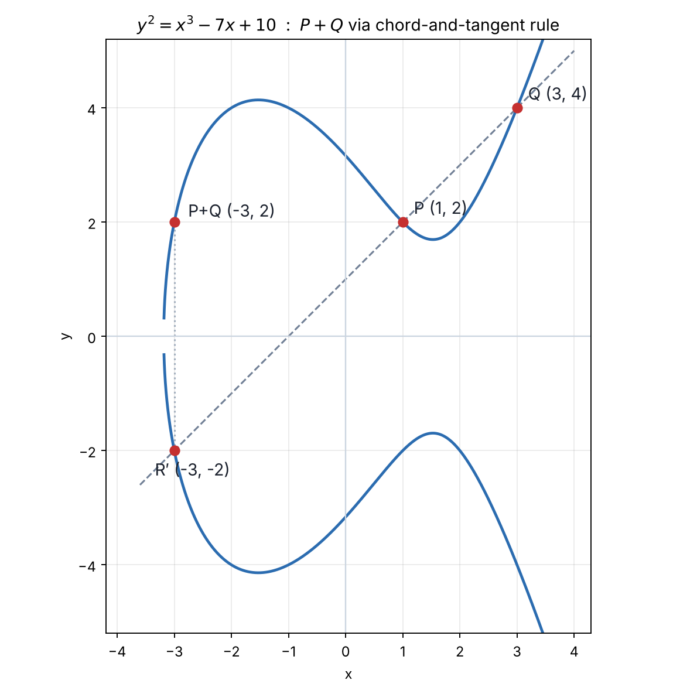
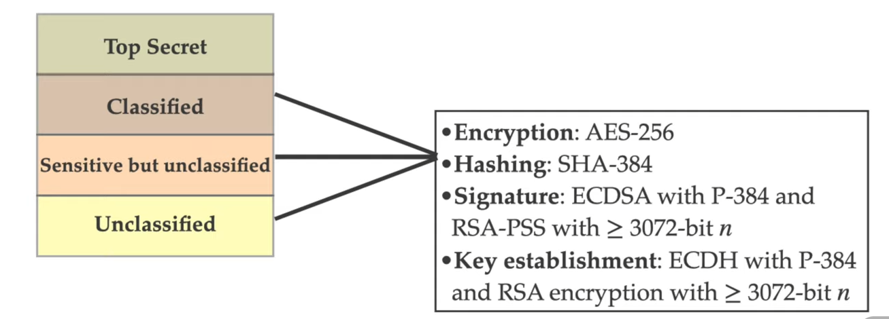

## ECC의 등장배경

RSA라는 공개키 암호가 있는데 타원곡선 암호(ECC, Elliptic Curve Cryptography)는 왜 나온 것일까? RSA는 큰 정수의 소인수분해 문제(IFP)의 어려움에 기반하는데, 가장 빠른 공격(GNFS)도 subexponential 시간이 걸린다. 반면 ECC는 타원곡선 이산로그 문제(ECDLP)의 어려움에 기반하는데, 가장 빠르다고 알려진 공격(Pollard's rho 등)도 fully exponential 시간이 걸린다. 따라서 같은 보안 수준을 달성하는 데 ECC가 RSA보다 훨씬 더 적은 비트 수의 파라미터를 쓴다.

| security level | Bit length of RSA n | Bit length of ECC p |
|---|---|---|
| 80 | 1024 | 160 |
| 112 | 2048 | 224 |
| 128 | 3072 | 256 |
| 192 | 7680 | 384 |
| 256 | 15360 | 512 |

  <iframe src="https://www.youtube.com/embed/uob23iLMlxk" title="YouTube Shorts" style="width: 100%; height: 100%; border: 0; border-radius: 4px;" loading="lazy" allow="accelerometer; autoplay; clipboard-write; encrypted-media; gyroscope; picture-in-picture; web-share" allowfullscreen></iframe>

점 덧셈부터 $\mathbb{F}_{17}$ 위의 스칼라곱, 곱셈 쪽은 왜 안 되는지까지 아래 글에서 다룰 핵심을 짧게 먼저 보여준다.

## 타원곡선과 점 덧셈

체 $F$ 위의 (단순화한 바이어슈트라스 표준형) 타원곡선은 다음 방정식을 만족하는 점들의 집합이다.

$$ E: y^2 = x^3 + ax + b, \quad 4a^3 + 27b^2 \neq 0 $$

($4a^3+27b^2 \neq 0$은 곡선에 특이점(중근)이 생기지 않게 하는 조건이다.) 이 짧은 바이어슈트라스 형태는 체의 표수(characteristic)가 $2, 3$이 아닐 때만 쓸 수 있다. 표수 $2$ 또는 $3$인 체에서는 일반형 바이어슈트라스 방정식을 따로 써야 한다. 이 글이 다루는 $\mathbb{F}_p$($p$는 큰 소수)는 표수가 $p$이므로 이 조건을 항상 만족한다. 여기에 무한원점(point at infinity) $O$를 하나 더 포함시킨다. $O$는 좌표평면에는 그릴 수 없지만 "모든 수직선이 만나는" 가상의 점으로, 뒤에서 보듯 덧셈의 항등원 역할을 한다.

### 기하학적 정의 (chord-and-tangent rule)

곡선 위의 서로 다른 두 점 $P, Q$가 있을 때,

1. 두 점을 지나는 직선을 긋는다. 3차 곡선이므로 이 직선은 곡선과 정확히 한 점을 더 만난다. 이 점을 $R'$라 하자.
2. $R'$를 x축에 대해 대칭이동한 점을 $P+Q$로 정의한다.

$P=Q$일 때(점의 두 배, doubling)는 두 점을 지나는 직선 대신 $P$에서의 접선을 쓴다. $Q=-P$(같은 x좌표, 반대 부호의 y좌표)일 때는 두 점을 지나는 직선이 수직선이 되어 곡선과 세 번째 교점을 갖지 않는데, 이 경우의 "세 번째 교점"을 무한원점 $O$로 약속한다. 즉 $P+(-P)=O$이고, 이로써 $O$가 덧셈의 항등원이 된다.

아래는 $y^2=x^3-7x+10$ 곡선 위에서 $P=(1,2)$와 $Q=(3,4)$를 더하는 과정이다. $P,Q$를 지나는 직선은 $y=x+1$이고, 이 직선은 곡선과 세 번째 점 $R'=(-3,-2)$에서 만난다. $R'$를 x축으로 반사하면 $P+Q=(-3,2)$를 얻는다.

*$y^2=x^3-7x+10$ 위에서 chord-and-tangent rule로 $P+Q$를 구하는 과정. 사선은 $P,Q$를 지나는 직선, 점선 수직선은 $R'$를 x축으로 반사하는 과정이다.*

이렇게 "세 번째 교점을 반사"하는 이유는, 세 점이 한 직선 위에 있을 조건과 "덧셈 결과가 결합법칙을 만족하는 군이 되는 조건"을 맞추기 위해서다. 결합법칙 $(P+Q)+R=P+(Q+R)$ 자체의 증명은 좌표를 직접 대입해 확인하거나 대수기하의 약수(divisor) 이론으로 보이는데 꽤 길어서 여기서는 생략한다. (Silverman, *The Arithmetic of Elliptic Curves* 참고)

### 좌표 공식

$P=(x_1,y_1)$, $Q=(x_2,y_2)$이고 $P \neq \pm Q$일 때,

$$ \lambda = \frac{y_2-y_1}{x_2-x_1}, \quad x_3 = \lambda^2 - x_1 - x_2, \quad y_3 = \lambda(x_1-x_3) - y_1 $$

$P=Q$일 때(점 두 배, doubling)는 접선의 기울기를 쓴다.

$$ \lambda = \frac{3x_1^2+a}{2y_1}, \quad x_3 = \lambda^2 - 2x_1, \quad y_3 = \lambda(x_1-x_3) - y_1 $$

항등원은 $O$, 역원은 $-P=(x_1,-y_1)$이다. 위 그림을 검산하면 $\lambda=(4-2)/(3-1)=1$, $x_3=1^2-1-3=-3$, $y_3=1\cdot(1-(-3))-2=2$이므로 $P+Q=(-3,2)$로 그림과 일치한다. 점 두 배 $2P$도 같은 곡선에서 검산할 수 있다: $\lambda=(3\cdot1^2-7)/(2\cdot2)=-1$, $x_3=1-2=-1$, $y_3=-1\cdot(1-(-1))-2=-4$이므로 $2P=(-1,-4)$다.

이렇게 정의한 $(E,+)$는 교환법칙까지 만족하는 아벨군(abelian group)이다.

## 모듈로 연산을 쓰는 이유

실수체 $\mathbb{R}$ 위에서는 방금 정의한 점 덧셈을 실제 암호에 쓸 수 없다. $E(\mathbb{R})$의 (한 실수 성분으로 된) 부분은 원(circle) 군 $\mathbb{R}/\mathbb{Z}$와 군으로서 동형인데, 점 $P$를 타원적분 $t=\int_x^{\infty} dx'/y'$로 매개변수화하면 스칼라곱 $kP$가 그냥 보통의 실수 곱셈 $k \cdot t_G \pmod 1$이 되어버린다. 즉 $G, Q=kG$가 주어지면 타원적분을 수치적으로 계산해(AGM 등으로 다항시간에 가능) $k \approx t_Q / t_G$를 나눗셈으로 구할 수 있다. 이산로그가 나눗셈 한 번으로 풀리는 셈이니, $\mathbb{R}$ 위에서는 ECDLP가 전혀 어려운 문제가 아니다.

그래서 ECC는 유한체(finite field) $\mathbb{F}_p$($p$는 소수) 위에서 곡선을 정의한다.

$$ E(\mathbb{F}_p) = \{(x,y) \in \mathbb{F}_p \times \mathbb{F}_p : y^2 \equiv x^3+ax+b \pmod p\} \cup \{O\} $$

$\mathbb{F}_p$는 순서도 거리도 극한도 없는 구조라서 타원적분 같은 해석적 지름길을 쓸 방법이 없다. 그래서 알려진 가장 빠른 공격이 Pollard's rho 같은 범용 군 공격(위수 $n$에 대해 $O(\sqrt{n})$)뿐이고, 이게 ECC 보안의 근거가 된다.

### $E(\mathbb{F}_p)$의 특성

- **유한군**: $\mathbb{F}_p \times \mathbb{F}_p$가 유한집합이므로 $E(\mathbb{F}_p)$도 당연히 유한하다. 앞서 정의한 덧셈 공식을 그대로 쓰되, 모든 연산을 $\bmod\ p$로 수행한다.
- **하세의 정리(Hasse's theorem)**: 점의 개수 $|E(\mathbb{F}_p)|$는 다음을 만족한다.

$$ \big| \, |E(\mathbb{F}_p)| - (p+1) \, \big| \leq 2\sqrt{p} $$

  즉 군의 크기($|E(\mathbb{F}_p)|$)는 대략 $p$와 같다. "ECC의 등장배경"에서 본 표에서 RSA $n$의 비트 길이와 ECC $p$의 비트 길이를 직접 비교할 수 있었던 이유가 이것이다 — 공격 복잡도를 좌우하는 군의 크기가 $p$ 하나로 거의 결정되기 때문이다.
- **아벨군**: 점 덧셈이 교환법칙을 만족하므로(앞서 본 기하학적 정의 그대로), $E(\mathbb{F}_p)$는 유한 아벨군이다.

> 아무 $p, a, b$나 쓴다고 안전한 게 아니다. 대표적으로 피해야 하는 경우가 두 가지 있다.
> - **이상 곡선(anomalous curve)**: $|E(\mathbb{F}_p)| = p$인 경우다. 이때는 $p$진수($p$-adic) 해석을 이용해 ECDLP를 덧셈군 $(\mathbb{F}_p, +)$ 위의 이산로그로 환원할 수 있는데, $(\mathbb{F}_p, +)$에서는 이산로그가 그냥 모듈러 나눗셈이라 즉시 풀린다(Smart·Semaev·Satoh–Araki 공격). 위에서 본 "$\mathbb{R}$ 위에서 ECDLP가 쉬운 이유"와 정확히 같은 패턴이다 — 결국 "쉬운 군으로 환원되는가"가 관건이다.
> - **임베딩 차수가 작은 곡선**: $|E(\mathbb{F}_p)|$를 나누는 작은 $k$에 대해 $n \mid p^k-1$이면, 페어링(Weil/Tate pairing)을 이용해 ECDLP를 $\mathbb{F}_{p^k}^{*}$ 위의 이산로그(subexponential index calculus 적용 가능)로 환원할 수 있다(MOV 공격). 슈퍼싱귤러(supersingular) 곡선이 여기 해당해서 일반적인 ECC에는 쓰지 않는다.
>
> NIST P-256 같은 표준 곡선은 이런 조건들을 피하도록 검증된 파라미터다.
{: .prompt-warning }

## ECDLP (Elliptic Curve Discrete Logarithm Problem)

$E(\mathbb{F}_p)$ 위의 점 $G$(위수 $n$)와 $Q = kG$가 주어졌을 때, $k \in [0, n-1]$을 구하는 문제를 타원곡선 이산로그 문제(ECDLP)라 한다.

$\mathbb{F}_p^{*}$ 위의 일반 이산로그(DLP)나 RSA의 소인수분해 문제(IFP)는 index calculus 같은 subexponential 알고리즘이 있지만, 위에서 본 것처럼 안전하게 고른 $E(\mathbb{F}_p)$에는 그런 지름길이 없다. 그래서 "ECC의 등장배경"에서 봤듯 같은 보안 강도를 더 작은 비트 수로 달성할 수 있다.

$G$가 생성하는 부분군 $H=\langle G \rangle$의 위수를 $q$라 하면, 곡선 구조를 이용하지 않는 일반적인 공격 중 가장 빠른 것은 Pollard's rho로 $O(\sqrt{q})$ 시간이 걸린다. 공격 복잡도가 $q$에 지수적으로(정확히는 $q$의 제곱근 크기로) 커지기 때문에, $q$의 비트 수만 적당히 크면 ECDLP는 계산적으로 풀 수 없는 문제가 된다.

> $G$의 위수 $q$는 반드시 소수여야 한다. $q$가 합성수라서 작은 소인수들로 쪼개지면, Pohlig–Hellman 알고리즘으로 각 소인수 크기의 부분군에서 따로 이산로그를 푼 뒤 중국인의 나머지 정리(CRT)로 조합해 전체 $k$를 복원할 수 있다. 이러면 실제 안전성은 $q$ 전체 크기가 아니라 $q$의 **가장 큰 소인수** 크기로 떨어져 버린다. 그래서 표준 곡선들은 $G$가 생성하는 부분군의 위수가 소수이거나(P-256처럼 코사이즈(cofactor) $h=1$), 적어도 $h$가 아주 작도록(Curve25519의 $h=8$ 등) 설계한다. 직접 곡선을 설계하는 대신 이런 검증된 표준 곡선·생성점을 그대로 가져다 쓰는 게 권장되는 이유이기도 하다.
{: .prompt-tip }

## 타원곡선 암호의 예

ECDLP의 어려움을 이용하는 대표적인 암호는 다음과 같다. 아래에서 실제 표준 곡선(P-256)을 하나 본 뒤, 이 중 ECDH를 자세히 다룬다.

| 용도 | 이름 | 비고 |
|---|---|---|
| 키 교환 | ECDH | 뒤에서 자세히 다룬다 |
| 전자서명 | ECDSA | 뒤에서 따로 정리할 예정 |
| 공개키 암호화 | EC-ElGamal / ECIES | "동형암호" 절에서 다룬 덧셈 동형 성질이 여기서 쓰인다 |

## 여러 표준 곡선

- P-256
- P-384
- P-521
- SM2 elliptic curve (중국 국가암호관리국 표준)
- CNSA (미국 NSA의 상용 국가보안 알고리즘 스위트) — 곡선 자체가 아니라, 분류 등급별로 어떤 알고리즘·곡선을 써야 하는지 지정한 규격이다. 아래 표처럼 서명·키교환 모두 P-384를 쓰도록 명시한다.

*CNSA가 분류 등급별로 요구하는 암호 알고리즘. 서명(ECDSA)과 키교환(ECDH) 모두 P-384를 지정한다.*

## P-256 Elliptic Curve

이 중 가장 널리 쓰이는 게 P-256이다. 자세히 살펴보자.

$$ p = 2^{256} - 2^{224} + 2^{192} + 2^{96} - 1 $$

p는 2의 거듭제곱 5개의 합과 차로 이루어진 소수다.

`P-256`은 앞서 정의한 일반형 $E:y^2=x^3+ax+b$에서 $a=-3$으로 고정한 곡선이다.

$$ E/\mathbb{F}_p: Y^2 = X^3 - 3X + b \pmod{p}, \quad 0 < b < p $$

P-256에는 기준점이 되는 점 $G$가 있고 비밀키 정수 $k$가 있을 때, 위에서 정의한 덧셈을 이용해 $G$를 $k$번 더하는 연산(스칼라곱)으로 공개키 $Q=kG$를 만든다. 이 스칼라곱은 $f(k)=kG$가 $f(a+b)=f(a)+f(b)$를 만족하는 준동형사상(homomorphism)이라는 중요한 성질을 갖는데, 왜 그런지는 뒤의 "동형암호" 절에서 자세히 다룬다.

## ECDH 키 교환

위에서 살펴본 것처럼 준동형사상이 성립하기 때문에, 비밀통신을 하는 앨리스와 밥이 있을 때 앨리스가 $(a \cdot G)$를 보내고 밥이 $b$를 곱한 것이나, 밥이 $(b \cdot G)$를 보내고 앨리스가 $a$를 곱한 것이나 둘 다 $(ab) \cdot G$로 같은 값이 나오게 된다.

## 동형암호 (Homomorphic Encryption)

> 이 항목은 원래 "영지식 증명"으로 적혀 있었는데, 적힌 설명("데이터가 암호화된 상태에서 원본 데이터를 곱하거나 더하는 연산이 잘 작동한다")은 영지식 증명이 아니라 **동형암호**를 가리킨다. 영지식 증명(Zero-Knowledge Proof)은 비밀값 자체는 공개하지 않으면서 "그 값을 안다"는 사실만 증명하는 것으로, 완전히 다른 개념이다. (예: ECDSA/Schnorr 서명에서 비밀키 k를 공개하지 않고 $kG=Q$를 안다는 것만 증명하는 것)
{: .prompt-warning }

데이터를 암호화한 상태 그대로 더하거나 곱하는 연산을 수행했을 때, 그 결과를 복호화하면 평문을 먼저 연산한 것과 같은 값이 나오는 성질을 동형암호라고 한다. 앞서 본 스칼라곱의 준동형사상($f(k)=k \cdot G$)이 바로 이 성질의 한 예이며, EC-ElGamal 같은 ECC 기반 암호는 덧셈에 대해 부분적으로 동형(partially homomorphic)이다. (메시지를 곡선 위의 점 $M$으로 직접 쓰는 인코딩과, 정수 $m$을 $mG$로 올려 쓰는 인코딩 둘 다 추상적으로는 같은 덧셈 동형 구조를 가지며, 실제 구현에서는 보통 후자($mG$)를 쓴다.)

### 왜 ECC는 "덧셈"에 대해 동형인가

앞서 본 스칼라곱 $f(k)=k \cdot G$가 $f(a+b)=f(a)+f(b)$를 만족하는 이유를 조금 더 엄밀하게 짚어 보자.

먼저, 정수 집합 $\mathbb{Z}$는 **곱셈에 대해서는 군이 아니다.** 군이 되려면 모든 원소가 역원을 가져야 하는데, 정수 중 곱셈에 대한 역원을 갖는 것은 $1, -1$뿐이다(예: $2$의 역원 $1/2$은 정수가 아니다). 즉 $(\mathbb{Z}, \times)$는 모노이드일 뿐 군이 아니다. 반면 $(\mathbb{Z}, +)$는 모든 정수 $n$에 대해 역원 $-n$이 존재하므로 군이다.

그런데 "스칼라곱 $kP$"는 애초에 곱셈으로 정의된 연산이 아니라, 위에서 정의한 $(E,+)$ 위에서 $P$를 $k$번 더하는 것(반복된 덧셈)으로 정의된다.

$$ kP = \underbrace{P+P+\cdots+P}_{k\text{번}} $$

이건 타원곡선만 갖는 특별한 구조가 아니라 **아벨군이면 항상 갖는 구조**다. 임의의 아벨군 $(A,+)$와 정수 $k$, 원소 $x \in A$에 대해 "$k$번 더하기"는 항상 정의할 수 있고($k<0$이면 $-x$를 $|k|$번 더한다), 이는 $\mathbb{Z}$가 환(ring)으로서 임의의 아벨군을 $\mathbb{Z}$-가군($\mathbb{Z}$-module)으로 만드는 자연스러운 작용(action)이다. 이 작용은 분배법칙 때문에 자동으로 다음을 만족한다.

$$ (a+b)P = aP + bP $$

즉 $f(k)=kP$가 $f(a+b)=f(a)+f(b)$를 만족하는 것은 타원곡선의 특수한 성질이 아니라, "$(\mathbb{Z},+)$는 군이고, 모든 아벨군은 자연스럽게 $\mathbb{Z}$의 작용을 받는다"는 일반적인 대수학 사실의 결과다.

그렇다면 "곱셈 쪽"에는 대응되는 동형사상이 없을까? 정확히 말하면 **애초에 비교할 대상이 없다.** 타원곡선 $E$에는 연산이 덧셈 하나뿐이고, 점과 점을 곱하는 연산 $P \times Q$ 자체가 정의되어 있지 않다. ($(\mathbb{Z},\times)$가 군이 아니라는 사실 자체는 핵심이 아니다 — 모노이드 사이의 준동형사상도 얼마든지 존재한다. 진짜 이유는 $E$ 쪽에 "곱셈"이라는 연산 자체가 없어서, "$f$가 곱셈에 대해서도 동형인가"라는 질문이 애초에 성립하지 않는다는 것이다.)

대신 곱셈 쪽에서 실제로 성립하는 건 따로 있다. $\mathbb{Z}$-가군 작용의 결합법칙으로부터 다음이 자동으로 나온다.

$$ f(ab) = (ab)P = a(bP) = a \cdot f(b) $$

이건 "$f$가 곱셈에 대해 동형사상이다"라는 뜻이 아니라, **정수 $a$가 점 $f(b)$에 다시 작용한 결과가 $f(ab)$와 같다**는 뜻이다. 그리고 이게 바로 ECDH가 작동하는 이유다: $a(bG) = b(aG) = (ab)G$.

> 암호에서 실제로 쓰는 스칼라 $k$는 $G$의 위수(order) $n$에 대해 $k \bmod n$만 의미를 가진다. $nG=O$이기 때문이다. 그래서 $f$는 사실상 $\mathbb{Z}/n\mathbb{Z} \to \langle G \rangle$ 사이의 동형사상(isomorphism)이 된다.
{: .prompt-tip }

### 덧셈적 동형 vs. 곱셈적 동형

여기서 흥미로운 대조가 생긴다. 고전적인 이산로그 기반 암호(ElGamal 등)는 $(\mathbb{Z}/p\mathbb{Z})^{*}$처럼 군의 연산이 **곱셈**으로 쓰이는 군 위에서 동작한다. 거기서는 $f(k)=g^k \pmod p$가 $f(a+b)=f(a)\cdot f(b)$를 만족하고($g^{a+b}=g^a g^b$), 이게 (곱셈적) 동형암호의 바탕이 된다.

타원곡선은 군의 연산 자체를 **덧셈**으로 쓴다(바로 앞에서 기하학적으로 정의한 $P+Q$). 그래서 똑같은 논리가 $f(k)=kG$에 적용되면 $f(a+b)=f(a)+f(b)$, 즉 결과가 "덧셈"에 대해 동형이 된다. EC-ElGamal이 (일반 ElGamal과 달리) 덧셈 동형암호로 분류되는 이유가 이것이다 — 타원곡선이라서 특별히 더하기가 되는 게 아니라, 군의 연산을 애초에 덧셈 표기로 쓰기 때문이다.

## Modular Reduction

P-256과 P-384는 모듈로 p 감산이 32비트 머신에서도 충분히 쉽게 구현된다. 타원곡선 점 덧셈 연산은 유한체 위에서의 모듈로 덧셈, 뺄셈, 곱셈, 제곱으로 수행된다. 64비트 머신에서 $p = 2^{192} - 2^{64} - 1$ (P-192)인 경우를 예로 들어 보자.

$a, b \in [0, p-1]$이고 $c = a \times b \bmod p$를 계산하고 싶다고 하자. p가 192비트이므로 a, b는 각각 최대 192비트이고, 각각 64비트 워드 3개로 나뉜다. 즉 $a = a_2 \cdot 2^{128} + a_1 \cdot 2^{64} + a_0$, $b = b_2 \cdot 2^{128} + b_1 \cdot 2^{64} + b_0$이다. 곱 $c = a \times b$는 최대 384비트이므로 64비트 워드 6개로 나누어 쓰면

$$ c = c_5 \cdot 2^{320} + c_4 \cdot 2^{256} + c_3 \cdot 2^{192} + c_2 \cdot 2^{128} + c_1 \cdot 2^{64} + c_0 $$

이다. 여기서 $2^{192} \equiv 2^{64} + 1 \pmod{p}$라는 사실을 이용하면, 상위 워드($c_3, c_4, c_5$)를 나눗셈 없이 덧셈·뺄셈만으로 하위 자리에 접어 넣을 수 있다. $(x_2,x_1,x_0)$를 $x_2 \cdot 2^{128} + x_1 \cdot 2^{64} + x_0$로 정의하면, 실제 reduction 공식은 다음과 같다.

$$ c \bmod p \equiv (c_2, c_1, c_0) + (c_5, c_5, c_5) + (c_4, c_4, 0) + (0, c_3, c_3) \pmod{p} $$

나눗셈 대신 덧셈 4번으로 384비트 곱을 192비트 범위로 줄이는 것이 핵심이고, 결과가 p 이상이면 p를 한 번 더 빼서 범위를 맞춘다.

> 출처: Brown, Hankerson, López, Menezes, *Guide to Elliptic Curve Cryptography* 기준 Algorithm 7 (NIST P-192 fast reduction).
{: .prompt-tip }

## 실습

실습은 Cryptohack의 Challenges를 푸는것으로 진행한다. [CryptoHack의 Elliptic Curves 카테고리](https://cryptohack.org/challenges/ecc/)의 Starter 챕터로 점 덧셈·역원·스칼라 곱·ECDH를 하나씩 구현해보며 익혔고, 풀이는 [CryptoHack · Elliptic Curves]()에 따로 정리한다.

---

## 참고 자료
- [NIST FIPS 186-4, Digital Signature Standard (DSS)](https://nvlpubs.nist.gov/nistpubs/FIPS/NIST.FIPS.186-4.pdf)
- [asecuritysite.com - P-256](https://asecuritysite.com/ecc/p256p)
- Silverman, *The Arithmetic of Elliptic Curves*, Springer. (점 덧셈과 결합법칙, 하세의 정리)
- Hankerson, Menezes, Vanstone, *Guide to Elliptic Curve Cryptography*, Springer. (이상 곡선·MOV 공격 등 곡선 선택 기준)
- Menezes, Okamoto, Vanstone, "Reducing Elliptic Curve Logarithms to Logarithms in a Finite Field", 1993. (MOV 공격)
